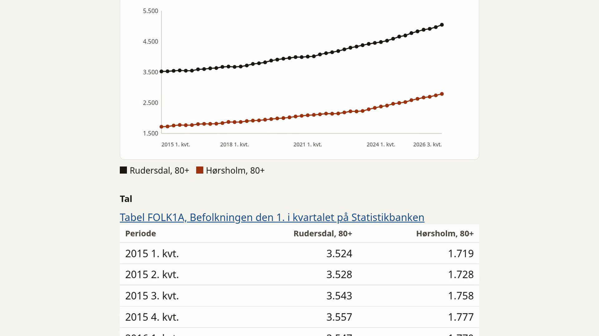

# statistikbanken-mcp

Language models invent numbers. This project fetches the figure from [Danmarks Statistik](https://www.dst.dk)'s public [Statistikbanken](https://www.statistikbanken.dk) and cites the table id and period. No API key.

Statistikbanken has more than 2,000 tables and no free-text search. An assistant gets three tools: find a table, read its codes, then fetch the rows.

## First answer

Python 3.11+ and [uv](https://docs.astral.sh/uv/).

```bash
git clone https://github.com/tottedk/statistikbanken-mcp.git
cd statistikbanken-mcp
uv sync
uv run python examples/esbjerg_80plus.py
```

That script calls the public API through the library. It does not start a language model or an MCP client. It prints people aged 80 and over in Esbjerg, the table, the latest published quarter, and the source:

```text
FOLK1A 2026K3: 7556 people aged 80+ in Esbjerg.
Source: Danmarks Statistik, Statistikbanken, table FOLK1A.
```

On 6 November 2026 that was still quarter 2026K3 and 7,556 people, the same figure checked on 1 November 2026. If Statistikbanken has published a later quarter, the script prints that period and its value.

`uv run statistikbanken-mcp` is the MCP server. It speaks stdio and waits for a client, so it prints no number. Use the command above when you want a figure.

## Examples

Checked against `https://api.statbank.dk` on 1 November 2026. The unit is people (`Antal`) unless a row says otherwise. Source: Danmarks Statistik.

**How many people over 80 live in Esbjerg?** `find_tabel("befolkning")` returns `FOLK1A`, "Befolkningen den 1. i kvartalet", latest period `2026K3`. Ages in FOLK1A are single years, so `sum_from` asks the API to add 80 through 125:

```text
hent_data(
  table="FOLK1A",
  values={"OMRÅDE": ["Esbjerg"], "KØN": ["TOT"], "CIVILSTAND": ["TOT"], "Tid": ["(1)"]},
  sum_from={"ALDER": "80"}
)
```

| Table | Period | Place | Age | Value |
|---|---|---|---|---|
| FOLK1A | 2026K3 | Esbjerg | 80+ | 7,556 |

**Children aged 0–17 in Esbjerg and Viborg**, same table and quarter, with `sum_range={"ALDER": ["0", "17"]}`: Esbjerg 21,616, Viborg 19,171.

**A misspelled name.** `OMRÅDE: ["Kobenhavn"]` resolves to København. Total population in FOLK1A, 2026K3: 670,389.

The same six questions are asserted from recorded responses in `tests/test_acceptance.py`:

1. People over 80 in Esbjerg. FOLK1A 2026K3: 7,556.
2. Viborg's population over ten years. FOLK1A: 96,166 in 2016K3, 98,104 in 2026K3.
3. People over 80 in Gentofte, Esbjerg, and Viborg. FOLK1A 2026K3: 5,486 / 7,556 / 6,420.
4. Association members in Esbjerg. The nearest table is IDRFOR01 (sports clubs, not every association), 2025: 212 clubs and 54,205 memberships. Viborg: 208 and 49,821.
5. Children aged 0–17 in Esbjerg and Viborg. FOLK1A 2026K3: 21,616 / 19,171.
6. Average income in total before tax in Esbjerg and Viborg. INDKP105 2025: 407,775 / 402,605.

## Demo

[](demo/statistikbanken-demo-v2.mp4)

[Watch the demo](demo/statistikbanken-demo-v2.mp4) (about two minutes). The recording and the poster are an earlier local run. They ask about Rudersdal and Hørsholm, so the places on screen are not the Esbjerg and Viborg examples above. The page, the Basis/Avanceret switch, the FOLK1A source link, and the number guard are the same.

## Tools

Names are Danish. Arguments and descriptions are English.

| Tool | Purpose |
|---|---|
| `find_tabel` | Search by id, title, and variable name. Some words are enough. Municipality names are matched on FOLK1A and returned with their codes. Population by municipality or age leads with FOLK1A, population by origin with FOLK1E, registered unemployment with AUS08, personal income with INDKP105, and reported crimes with STRAF10. A miss is an error, not an empty list. |
| `tabelinfo` | Variables and the codes `hent_data` accepts. Time is first, last, and count. Long value lists are capped; `values_filter` looks up the rest. |
| `hent_data` | Fetch rows. Values may be codes or labels (`Esbjerg`, `Kobenhavn`). A variable left out is set to a top-level total and listed in `defaults`. Time left out is the latest published period. `sum_from` and `sum_range` use the API's own sum. A complete year on a quarterly or monthly table is one yearly figure: flows are added, levels are averaged, and the note says which. `i år`, `i fjor`, `sidste år`, and `sidste måned` follow today's calendar. A trailing 0 marked `unpublished` is not published yet. A fremskrivning table, or a row labelled prognose, is marked `projection`. |

Read `title`, `description`, `unit`, and `periods` on the result. They say what the number measures.

## MCP server

Cursor, in `~/.cursor/mcp.json` or the project `.cursor/mcp.json`. Use the absolute path of this repo:

```json
{
  "mcpServers": {
    "statistikbanken": {
      "command": "uv",
      "args": [
        "--directory",
        "/absolute/path/to/statistikbanken-mcp",
        "run",
        "statistikbanken-mcp"
      ]
    }
  }
}
```

Any other host that launches a local command over stdio can use the same `command` and `args`.

MCP Inspector needs Node.js, because `mcp dev` starts it with `npx`:

```bash
uv run mcp dev src/statistikbanken_mcp/server.py
```

## Web page

`statistikbanken-web` is a local page. It asks an OpenAI-compatible chat client, Ollama or xAI, to call the same three tools.

```bash
uv run statistikbanken-web
```

Then open http://127.0.0.1:8080. The default bind is `127.0.0.1` port `8080`. `--host`, `--port`, `STATBANK_HOST`, and `STATBANK_PORT` change it. `PORT`, when set, is used instead of `STATBANK_PORT`. Copy `.env.example` to `.env` for the model and the question limits. `.env` is gitignored. The API key is not printed.

The page is in Danish. Ask in Danish or English. It opens in Basis, which shows the answer and a compact table. Avanceret adds the chart, the source link (`https://www.statistikbanken.dk/` plus the table id), CSV, Excel, and JSON built from the rows already on the page, and the tool calls. Switching view does not ask again.

Ollama is the default (`--llm ollama`). The model is `gemma4:26b-a4b-it-qat` at `http://127.0.0.1:11434/v1`. That tag's context is shorter than a tool-calling turn, so create a 16k tag and select it:

```text
FROM gemma4:26b-a4b-it-qat
PARAMETER num_ctx 16384
```

```bash
ollama create gemma4-16k -f Modelfile
STATBANK_MODEL=gemma4-16k uv run statistikbanken-web
```

Ollama thinking is off unless `STATBANK_LLM_THINK=1`. The system prompt states today's date in Europe/Copenhagen.

xAI uses `https://api.x.ai/v1`. Set `XAI_API_KEY` in the environment or in `.env`, not in the repo. The model is `STATBANK_XAI_MODEL`, or `grok-4` when that is unset. `grok-4` may be retired, so set the model when you deploy.

```bash
uv run statistikbanken-web --llm xai --model grok-4
```

### Number guard

A number in the model's answer has to come from the question or from rows fetched in that turn, including a difference, a sum, or a percentage that follows from those rows. A figure the model invents, or a fetched value tied to the wrong period or row, is hidden. If nothing was fetched, the page shows no number.

On a local `qwen2.5:14b`, some questions produced no tool call. The model wrote a fake tool error, such as HTTP 400 or 404, or an unknown function. The guard hid that prose. The same model also called the tools with a table id it made up, `INDKOMST1`, for average income in Esbjerg and Viborg. The tools reported that the table does not exist, the model did not recover, and no figure was shown. That income is in INDKP105.

`gemma4:26b-a4b-it-qat` with a 16k context was the better local default. It called the tools and invented fewer table ids. The guard still hid unverified figures. The remaining weakness is table choice: a nearby table can be a real Statistikbanken number that does not answer the question.

The scored run is Grok, not these local trials. See [evals/reports/2026-11-05-grok-4.md](evals/reports/2026-11-05-grok-4.md): 100 of 105 on `grok-4`, about $1.35. Five were not correct: Q7 (the guard hid a correct answer), Q48 (wrong table), Q52 (wrong period), Q76 (timeout), and Q104 (no answer).

## Why this, not a clone

Other MCP servers wrap Statistikbanken too, including Datavej. This one is three tools, `find_tabel`, `tabelinfo`, and `hent_data`, rather than a clone of the API's SUBJECTS, TABLES, INFO, and DATA endpoints. Search preferences, label lookup, and a yearly sum or average sit inside `hent_data`. The Danish web page has a number guard. A 105-question run against the live API is in the evaluation report above.

## Limits

- When several tables score the same, catalogue order wins, so the best table is often on the first page rather than always first.
- Place names in search come from FOLK1A's area list only.
- There is no table of all association membership by municipality. The nearest table, `IDRFOR01`, counts sports-club memberships, and its title says so.

## Evaluation

`evals/questions.json` holds 100 questions from 1 November 2026, plus five owner questions (101–105). The runner uses the same path as the web page (`answer_with_server` with `--llm xai`). It does not open a port. It is not part of `uv run pytest` or CI. A full run calls xAI and costs money.

```bash
uv run python -m evals.run
uv run python -m evals.run --limit 5
uv run python -m evals.run --model grok-4 --out evals/reports/custom.md
```

Set `XAI_API_KEY` in the environment, not in the repo. The key is not printed and not written to the report. The committed proof is [evals/reports/2026-11-05-grok-4.md](evals/reports/2026-11-05-grok-4.md).

## Tests

Unit tests replay responses recorded from the live API (`tests/fixtures/`). A smaller set calls the API directly, including the first-answer example and one session over stdio.

```bash
uv sync --group dev
uv run pytest -m "not live"   # fixtures only
uv run pytest -m live         # the real API
uv run pytest                 # both
uv run ruff check .
uv run ruff format --check .
```

GitHub Actions runs those Ruff commands and `uv run pytest` with no marker, so the live tests run there, on every push and pull request.

## Running as a public demo

The Docker image is optional. It is not required for the first answer above, and this repository does not host a public site.

```bash
docker build -t statistikbanken-web .
docker run --rm -p 8080:8080 \
  -e STATBANK_PUBLIC=1 \
  -e STATBANK_XAI_MODEL=grok-4 \
  -e XAI_API_KEY \
  statistikbanken-web
```

The image is Python 3.12. It listens on `STATBANK_HOST` (the image sets `0.0.0.0`) and on `PORT` when that is set, otherwise `STATBANK_PORT` (8080). `GET /healthz` returns 200 and does not call the model or Statistikbanken.

`STATBANK_PUBLIC=1` uses xAI only. The process exits at startup when `XAI_API_KEY` is missing. Pass the key in from the environment (`-e XAI_API_KEY` with no value copies it from the shell). Do not write `XAI_API_KEY` or `STATBANK_PROXY_SECRET` into a file, the image, or the repo. Set `STATBANK_XAI_MODEL` when you deploy. The default name `grok-4` may be retired.

Public defaults, each still overridable: 40 questions a day (`STATBANK_DAILY_CAP`), 3 per minute per visitor (`STATBANK_RATE_PER_MINUTE`), 6 tool calls, and 300 characters. At most two questions run at once. The daily count is kept in memory and starts again at zero when the process restarts. That is not a spending cap. The hard cap is the prepaid xAI credit. `STATBANK_DAILY_CAP=0` stops the demo. `STATBANK_STATE_FILE`, if set, stores the date and the daily count only.

The per-minute limit reads `CF-Connecting-IP`, or else the last `X-Forwarded-For` entry, only when `STATBANK_PROXY_SECRET` is set and the request carried that value in `X-Proxy-Secret`. Addresses are not logged. When the secret is set, every route except `/healthz` requires the header.

## Data and licence

Numbers come from Danmarks Statistik, [Statistikbanken](https://www.statistikbanken.dk), via [the public API](https://www.dst.dk/en/Statistik/hjaelp-til-statistikbanken/api). Danmarks Statistik states that the data may be used free of charge, including commercially, if you cite the source. They describe those terms as [Creative Commons CC BY 4.0](https://creativecommons.org/licenses/by/4.0/). A citation looks like: Danmarks Statistik, Statistikbanken, table FOLK1A.

The code is released under the [MIT licence](LICENSE).
